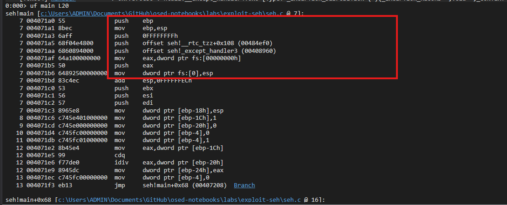
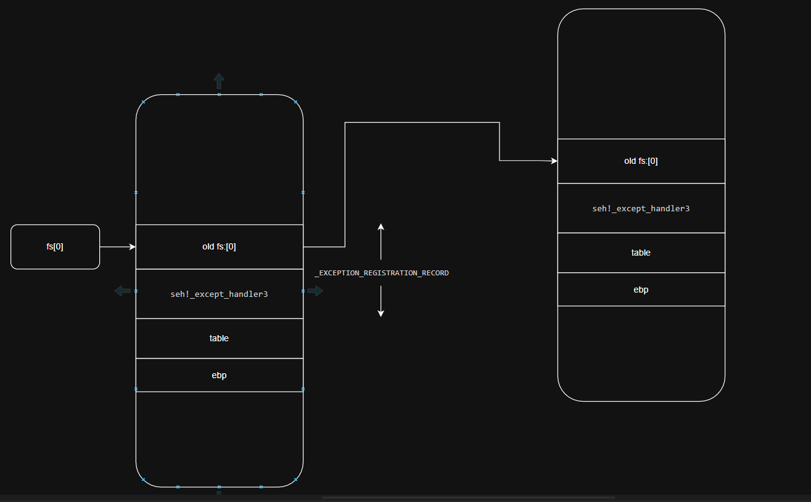
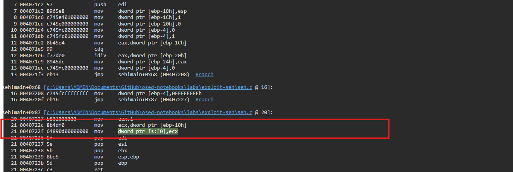
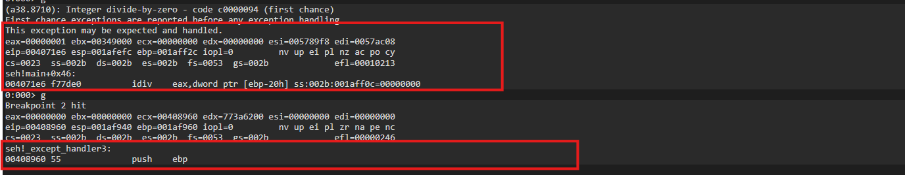
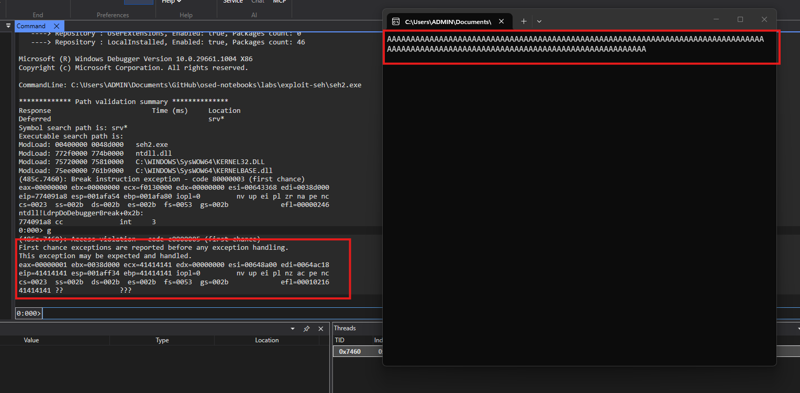
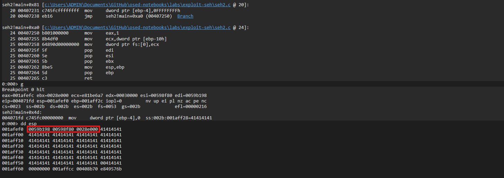
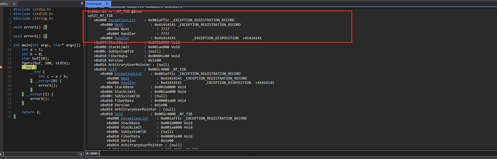
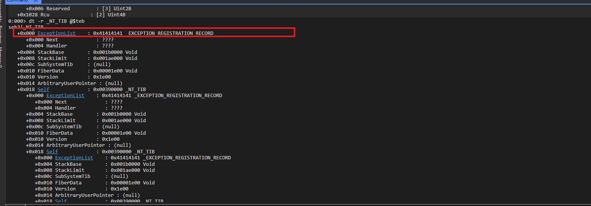

### Introduction SEH
Basic code C use SEH to handler error.
```c
void error1() {}

void error2() {}

int main() {
    int a = 1;
    int b = 0;
    __try {
        __try {
            int c = a / b;
        } __except(0) {
            error1();
        }
    } __except(1) {
        error2();
    }

    return 1;
}
```

In `except` code, have 3 value:
- EXCEPTION_EXECUTE_HANDLER = 1: Handler this except, stop search handler, jump into executing the code block (example like error1() and error2() function)
- EXCEPTION_CONTINUE_SEARCH = 0: Pass this handler, continue search next handler.
- EXCEPTION_CONTINUE_EXECUTION = -1: Pass this error, continue executing code error => crash.

Debug this code, we can see code initialize exception struct in the stack.



After prologue done, stack like this. The fs:[0] pointer to struct _EXCEPTION_REGISTRATION_RECORD in the stack, and the next pointer of struct pointer to another struct in the stack.



Struct __EXCEPTION_REGISTRATION_RECORD:
```c
0:000> dt _EXCEPTION_REGISTRATION_RECORD
seh!_EXCEPTION_REGISTRATION_RECORD
   +0x000 Next             : Ptr32 _EXCEPTION_REGISTRATION_RECORD
   +0x004 Handler          : Ptr32     _EXCEPTION_DISPOSITION 

```

See to the stack, old fs:[0] is [ebp + 10], the epilogue will restore the exception struct by restore value of fs:[0] to old fs:[0].



Breakpoint to _except_handler3(), error1(), error2() and run debug.



After except trigger, _except_handler3 will be call. So, we can overwrite pointer to this function in the stack to control this.

### Overflow SEH
Modify code to create overflow in the stack.

```c
#include <stdio.h>
#include <stdlib.h>
#include <string.h>

void error1() {}

void error2() {}

int main(int argc, char* argv[]) {
    int a = 1;
    int b = 0;
    char buf[10];
    fgets(buf, 100, stdin);
    __try {
        __try {
            int c = a / b;
        } __except(0) {
            error1();
        }
    } __except(1) {
        error2();
    }

    return 1;
}
```

Build code with cl.exe: `cl /GS- /Od /Zi /Fa /D_CRT_SECURE_NO_WARNINGS seh.c /link /DEBUG /SAFESEH:NO /DYNAMICBASE:NO /NXCOMPAT:NO`

Fill input with "AAAA..AAA", the program crashed with eip = 41414141.



But esp now don't pointer to my buffer, need a gadget to control this pointer the buffer, then execute code in this pointer. Have 4 bytes * 3 => Use `POP POP RET` gadget.



Struct SEH after prologue.


Struct SEH after epilogue.

